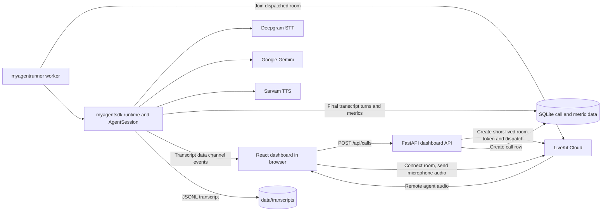
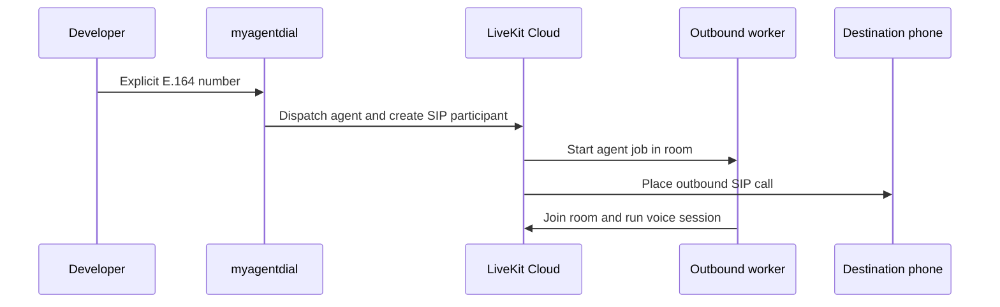
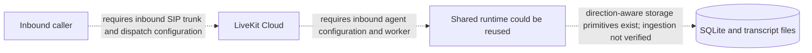

# MYvoiceagent

**A configuration-driven LiveKit voice-agent SDK, outbound call runner, and local web dashboard.**

MYvoiceagent provides a shared Python runtime for loading a customer voice agent from its folder, validating its model and session configuration, starting a LiveKit Agents session, and recording final conversation turns and latency samples. The repository also contains a React dashboard for launching browser-based outbound calls and reviewing their history, transcripts, and measured latency.

The project is intended for developers who want to prototype or extend a LiveKit voice agent without duplicating session setup, configuration loading, and basic call observability for every agent.

> **Current scope:** The repository contains both inbound and outbound agent files for `MyAgent`. Outbound browser calling and outbound SIP dialing are implemented; inbound SIP dispatch, dashboard/API integration, and end-to-end inbound call handling are **not implemented or verified**.

## Table of contents

- [Project introduction](#project-introduction)
- [Features and implementation status](#features-and-implementation-status)
- [Technology stack](#technology-stack)
- [Architecture](#architecture)
- [Project structure](#project-structure)
- [Prerequisites](#prerequisites)
- [Installation](#installation)
- [Environment configuration](#environment-configuration)
- [Agent configuration](#agent-configuration)
- [Running the project](#running-the-project)
- [Dashboard guide](#dashboard-guide)
- [HTTP API](#http-api)
- [Testing](#testing)
- [Troubleshooting](#troubleshooting)
- [Security and privacy](#security-and-privacy)
- [Limitations and roadmap](#limitations-and-roadmap)
- [Contributing](#contributing)
- [License](#license)

## Project introduction

### What it does

The project has two Python packages:

- `myagentsdk` contains shared agent configuration, a LiveKit `Agent` base class, session construction, a runtime, logging, and local call-data storage.
- `myagentrunner` selects a customer agent folder, creates a LiveKit `AgentServer`, starts the dashboard API, or places an explicitly requested outbound SIP call.

The current example agent, `MyAgent`, uses Deepgram for speech recognition, Google Gemini for language generation, Sarvam AI for speech synthesis, and Silero VAD for voice activity detection. A React dashboard provides a browser caller for outbound agent sessions and a local interface for reviewing saved data.

### Problem it solves

Each agent needs a way to connect its prompt, model settings, and LiveKit session lifecycle. This SDK centralizes that wiring and uses a consistent folder layout so an agent can be loaded by the runner. The dashboard adds a local development experience for testing browser calls and inspecting call transcripts and latency samples.

### Who can use it

- Developers building LiveKit Agents applications.
- Teams prototyping AI voice assistants and outbound call workflows.
- Contributors extending the shared runner, dashboard, or customer-agent examples.

This repository is a local-development project. The dashboard does not currently implement user authentication or production access controls.

## Features and implementation status

| Capability | Status | What is present |
|---|---|---|
| Shared LiveKit agent runtime | Implemented | Loads a configured customer agent and starts an `AgentSession` through LiveKit Agents. |
| Outbound browser calls | Implemented | The dashboard requests a short-lived LiveKit room token, connects a browser microphone, and dispatches the outbound agent. |
| Outbound SIP dialing | Implemented in code | `myagentdial` explicitly places a call to an E.164 phone number through a configured LiveKit SIP trunk. Actual calling requires a working trunk and provider setup. |
| Inbound voice-agent calls | **Not implemented / not verified** | Inbound agent files are present, but inbound SIP dispatch, dashboard/API integration, and end-to-end call handling are not implemented or verified. |
| LiveKit integration | Implemented | Uses LiveKit Agents, LiveKit API tokens/dispatch, and the LiveKit JavaScript client. |
| Speech-to-text (STT) | Implemented in configuration | The current agent config selects Deepgram `nova-3` with `en-IN`. Provider access and account quota are external requirements. |
| Language model (LLM) | Implemented in configuration | The current config selects Google Gemini `gemini-3.5-flash`. Provider access and availability depend on the Google account. |
| Text-to-speech (TTS) | Implemented in configuration | The current config selects Sarvam `bulbul:v4-flash`, `en-IN`, and speaker `ishita_en_customer`. |
| Voice activity detection | Implemented | Silero VAD is loaded during worker setup when configured. |
| Dashboard backend and frontend | Implemented for local use | FastAPI serves dashboard data and call-token endpoints; the Vite/React frontend provides the UI. |
| Live browser call experience | Implemented for outbound browser calls | The page streams caller/agent final transcript turns and plays subscribed remote audio. |
| Call history and transcripts | Implemented for calls recorded by the current runtime | Call metadata is stored in SQLite; final transcript turns are stored as per-call JSON Lines files. The dashboard routes currently filter to outbound calls. |
| Latency analytics | Implemented for recorded samples | Supported LiveKit per-turn metrics are stored and summarized as P50, P90, and mean values. Dashboard API analytics currently filter to outbound calls. |
| Telugu speech behavior | **Not verified** | The prompt asks for Telugu replies when the caller speaks Telugu, but the current TTS config supports only `en-IN`; Telugu TTS is not configured in the active agent. |
| Agent-initiated hangup tool | **Not implemented** | The prompt mentions an `end_call` tool, but the current agent source does not register that tool. |

Do not treat the presence of a CLI argument, old Git history, or a database row as proof that an end-to-end feature is currently supported.

## Technology stack

| Technology | Role |
|---|---|
| Python 3.10+ | Backend and SDK language; the package metadata declares `requires-python = ">=3.10"`. |
| LiveKit Agents | Agent abstraction, worker/session lifecycle, realtime audio, and turn handling. |
| LiveKit API | Room tokens, agent dispatch, and SIP participant operations. |
| Deepgram | STT provider configured by the example agent. |
| Google Gemini | LLM provider configured by the example agent through the LiveKit Google plugin. |
| Sarvam AI | TTS provider configured by the example agent through the LiveKit Sarvam plugin. |
| Silero VAD | Voice activity detection plugin, loaded during worker setup when selected. |
| FastAPI and Uvicorn | Local dashboard HTTP API and ASGI server. |
| SQLite | Local call metadata and latency-sample database. SQLite is included with Python. |
| React and TypeScript | Dashboard user interface. |
| Vite | Frontend development server and production bundler. |
| LiveKit JavaScript client | Browser room connection, microphone publishing, and remote audio playback. |
| Recharts | Dashboard charts. |
| Lucide React | Dashboard icons. |
| python-dotenv | Loads values from the repository `.env` file. |

Python dependencies are declared in `pyproject.toml`; frontend dependencies and their lockfile are in `frontend/package.json` and `frontend/package-lock.json`.

## Architecture

### Components

- **SDK (`myagentsdk`)** validates agent JSON configuration, loads the prompt and agent module, creates provider models and a LiveKit session, and captures transcript/metrics events.
- **Runner (`myagentrunner`)** resolves a customer agent folder and registers its runtime with a LiveKit `AgentServer`.
- **Customer agent** supplies `create_agent(config, instructions)` and a direction-specific prompt/configuration. Both `inbound/` and `outbound/` agent files are present; only the outbound call flow is currently implemented and verified end to end.
- **Dashboard API** discovers outbound agents, issues browser-call credentials, and reads call, transcript, and analytics data.
- **Dashboard frontend** calls the API, connects to a browser call, shows live transcript updates, and displays history and latency metrics.
- **SQLite and transcript files** persist call metadata and metrics in SQLite and final text turns in JSONL files.
- **External services** handle realtime room transport, STT, LLM responses, TTS, and (for SIP calls) telephone connectivity.

### Implemented outbound browser flow



### Outbound SIP flow

The `myagentdial` command validates an E.164 number, dispatches the configured outbound agent to a room, then requests a SIP participant through the configured LiveKit outbound trunk. The worker must be running and registered under the same agent name.



### Inbound flow status

Inbound agent files and a legacy inbound runtime are present. However, inbound SIP dispatch, dashboard/API integration, and end-to-end inbound call handling are not implemented or verified. The dashed path below is a potential extension, not an implemented flow.



## Project structure

```text
myvoiveagent-sdk/
|-- myagentsdk/
|   |-- agent.py                 # Shared LiveKit Agent base
|   |-- app.py                   # Registers a runtime with LiveKit AgentServer
|   |-- config.py                # JSON configuration parsing and validation
|   |-- observability.py         # SQLite, transcript storage, metrics, and logging
|   |-- runtime.py               # Loads the customer agent and runs its session
|   |-- secrets.py               # Dotenv loading and required-secret helper
|   `-- session.py               # Provider plugins and AgentSession construction
|-- myagentrunner/
|   |-- runner.py                # CLI worker runner and customer-directory resolver
|   |-- dashboard.py             # FastAPI dashboard backend
|   |-- dial.py                  # Explicit outbound SIP dial command
|   `-- customer/
|       |-- __init__.py
|       `-- MyAgent/
|           |-- __init__.py
|           |-- inbound/         # Inbound agent files; call flow is not verified
|           |   |-- __init__.py
|           |   |-- _runtime.py
|           |   |-- agent.py
|           |   |-- config.json
|           |   `-- prompt.md
|           `-- outbound/       # Current implemented call example
|               |-- agent.py
|               |-- config.json
|               `-- prompt/
|                   `-- prompt.md
|-- frontend/
|   |-- src/
|   |   |-- App.tsx              # Dashboard pages and browser call workflow
|   |   |-- main.tsx             # React entry point
|   |   `-- styles.css
|   |-- package.json
|   |-- package-lock.json
|   `-- vite.config.ts
|-- tests/                       # Python unittest suite
|-- .env.example                 # Credential-free environment template
|-- .gitignore
|-- pyproject.toml               # Python package and CLI declarations
|-- run_local.py                 # Starts local API, frontend, and worker
`-- README.md
```

The application creates `data/` and log directories at runtime. They are local state and should not be committed. A local `data/` directory can contain a SQLite database and transcript files.

## Prerequisites

### Software

- **Python 3.10 or newer.** This is the lower bound in `pyproject.toml`; Python 3.12 is the version used in the development environment. The project does not declare a tested upper bound.
- **Node.js supported by the current Vite dependency:** Node 18, Node 20, or Node 22 and newer. Node 21 is not in the declared Vite engine range. npm is installed with Node.js.
- **Git** to clone the repository.
- **Google Chrome** only if you want `run_local.py` to open a browser automatically. You can pass `--no-browser` and open the URL yourself.

On Windows, use PowerShell and the Python launcher (`py`) if available. The project also uses Uvicorn, LiveKit Agents, and browser media APIs; allow microphone access to the local dashboard when prompted.

### Accounts and services

To run a real agent or browser call, arrange credentials and access for:

- A LiveKit project, including its WebSocket URL, API key, and API secret.
- Deepgram STT.
- Google Gemini through the Google AI API.
- Sarvam AI TTS.
- A configured LiveKit outbound SIP trunk only if placing a telephone call with `myagentdial`.

Provider accounts, quotas, model access, telephone permissions, and charges are managed by those services. The dashboard and local test suite do not provision them.

## Installation

Replace `OWNER/REPOSITORY` below with the actual GitHub repository path.

### Windows PowerShell

1. **Clone the repository:**

   ```powershell
   git clone https://github.com/Vamshipepalla/myvoiceagent-sdk.git
   ```

2. **Enter the project folder:**

   ```powershell
   Set-Location myvoiveagent-sdk
   ```

3. **Create a Python virtual environment:**

   ```powershell
   py -3 -m venv .venv
   ```

4. **Activate it:**

   ```powershell
   .\.venv\Scripts\Activate.ps1
   ```

   If PowerShell blocks activation, allow scripts for only the current shell, then retry:

   ```powershell
   Set-ExecutionPolicy -Scope Process -ExecutionPolicy Bypass
   .\.venv\Scripts\Activate.ps1
   ```

5. **Install the Python project and dependencies:**

   ```powershell
   python -m pip install --upgrade pip
   python -m pip install -e .
   ```

6. **Install the frontend dependencies from the lockfile:**

   ```powershell
   Set-Location frontend
   npm ci
   Set-Location ..
   ```

7. **Create your local environment file:**

   ```powershell
   Copy-Item .env.example .env
   ```

   Edit `.env` using a local editor and add your own credentials. Do not paste credentials into source files or commit `.env`.

8. **Verify the source and frontend build:**

   ```powershell
   python -m unittest discover -s tests
   Set-Location frontend
   npm run build
   Set-Location ..
   ```

### macOS and Linux

Run these commands from a terminal. Replace the repository URL as described above.

```bash
git clone https://github.com/OWNER/REPOSITORY.git
cd myvoiveagent-sdk
python3 -m venv .venv
source .venv/bin/activate
python -m pip install --upgrade pip
python -m pip install -e .
cd frontend
npm ci
cd ..
cp .env.example .env
```

Edit `.env` with a local editor, then verify:

```bash
python -m unittest discover -s tests
cd frontend
npm run build
cd ..
```

The commands above use `python3` to create the environment and `python` after activation.

## Environment configuration

Copy `.env.example` to `.env`. The runner, dial command, dashboard backend, and local launcher load the repository-root `.env` without overwriting variables already set in the process environment.

| Variable | Required for | Description |
|---|---|---|
| `LIVEKIT_URL` | Agent worker, browser-call API, and local call setup | LiveKit project WebSocket URL. The example value is a placeholder and must be replaced with your project URL. |
| `LIVEKIT_API_KEY` | Agent worker and browser-call API | API key from the same LiveKit project as `LIVEKIT_URL`. |
| `LIVEKIT_API_SECRET` | Agent worker and browser-call API | Secret associated with the LiveKit API key. Keep it private. |
| `DEEPGRAM_API_KEY` | Current agent worker | Credential used by the Deepgram STT plugin. |
| `GOOGLE_API_KEY` | Current agent worker | Credential used by the LiveKit Google Gemini plugin. |
| `SARVAM_API_KEY` | Current agent worker | Credential used by the LiveKit Sarvam TTS plugin. |
| `SIP_OUTBOUND_TRUNK_ID` | `myagentdial` only | LiveKit outbound SIP trunk identifier. The dial command expects it to start with `ST_`. |
| `MYVOICEAGENT_DATA_DIR` | Optional | Override for the directory that stores `dashboard.sqlite3` and per-call transcripts. Defaults to the project `data/` directory. |
| `MYVOICEAGENT_LOG_DIR` | Optional | Override for application log storage. Defaults to the project `logs/` directory. |
| `NODE_EXE` | Optional, `run_local.py` only | Node executable path/name override. Defaults to `node`. |

`MYVOICEAGENT_WORKER_READY_FILE` is an internal launcher-to-worker readiness marker, normally set by `run_local.py`; it is not a provider credential and does not need to be added to `.env`.

The local launcher checks for LiveKit, Deepgram, Google, and Sarvam variables before starting the worker. The outbound dial command separately requires `SIP_OUTBOUND_TRUNK_ID`. Never put API keys, LiveKit secrets, or SIP credentials in `config.json`, prompts, tests, logs, screenshots, or issue reports.

## Agent configuration

### Agent directory

The runner resolves a direction-specific agent directory:

```text
myagentrunner/customer/<AgentName>/<direction>/
|-- agent.py
|-- config.json
`-- prompt/
    `-- prompt.md
```

The current outbound directory is `myagentrunner/customer/MyAgent/outbound/`; it contains `agent.py`, `config.json`, and `prompt/prompt.md`. The inbound files are under `myagentrunner/customer/MyAgent/inbound/` and include `agent.py`, `config.json`, `_runtime.py`, and `prompt.md`. The dashboard discovers only outbound configurations; the presence of inbound files does not mean inbound dispatch or calls work.

An agent module must expose:

```python
def create_agent(config: AgentConfig, instructions: str) -> Agent:
    ...
```

The returned object must be a LiveKit `Agent`; the built-in `AgentBase` stores the validated configuration and uses the prompt as LiveKit instructions.

### Current verified configuration shape

This example matches the current `MyAgent` configuration:

```json
{
  "name": "MyAgent",
  "prompt": "prompt/prompt.md",
  "models": {
    "stt": {
      "provider": "deepgram",
      "model": "nova-3",
      "language": "en-IN"
    },
    "llm": {
      "provider": "google",
      "model": "gemini-3.5-flash"
    },
    "tts": {
      "provider": "sarvam",
      "model": "bulbul:v4-flash",
      "language": "en-IN",
      "languages": ["en-IN"],
      "speaker": "ishita_en_customer",
      "api_key_env": "SARVAM_API_KEY"
    }
  },
  "session": {
    "user_away_timeout": 15,
    "turn_detection": "vad",
    "interruption_mode": "adaptive",
    "endpointing": {
      "mode": "dynamic",
      "min_delay": 0.5,
      "max_delay": 3.0,
      "alpha": 0.9
    }
  }
}
```

### Model settings

The `models` object has required `stt`, `llm`, and `tts` fields.

- A model may be a string such as `"deepgram/nova-3"` to request a LiveKit Inference model.
- Provider-specific model objects are supported for:
  - STT: `inference` or `deepgram`.
  - LLM: `inference` or `google`.
  - TTS: `inference` or `sarvam`.
- For direct Google provider use, the SDK reads `GOOGLE_API_KEY`.
- Sarvam configuration requires `api_key_env` and `speaker`. It accepts a default `language` and optional `languages` list; configured Sarvam language codes are validated by the SDK.
- Provider model availability and account access are controlled by the provider and can change independently of this repository.

### Session settings

The optional `session` object supports:

| Setting | Accepted values / behavior |
|---|---|
| `user_away_timeout` | Positive number of seconds or `null` to disable. |
| `turn_detection` | `auto`, `adaptive` (alias for `auto`), `stt`, `vad`, `realtime_llm`, or `manual`. |
| `interruption_mode` | `adaptive` or `vad`. |
| `endpointing.mode` | `fixed` or `dynamic`. |
| `endpointing.min_delay` | Non-negative number; must not exceed `max_delay`. |
| `endpointing.max_delay` | Positive number, at least `min_delay`. |
| `endpointing.alpha` | Number between 0 and 1. |

When `turn_detection` is `vad`, the SDK registers and loads Silero VAD during worker setup before handling calls.

### Prompts and direction

The configured prompt path is relative to the agent folder and must resolve inside that folder. Prompts guide agent behavior; they do not automatically add tools or provider capabilities. The outbound configuration points to `prompt/prompt.md`; the inbound configuration currently uses the root-level `prompt.md` through its legacy `_runtime.py`.

The active outbound TTS configuration supports English (`en-IN`) only. Although its prompt mentions Telugu replies, Telugu TTS is not enabled by that configuration. The inbound files are present, but their provider model availability and end-to-end call behavior have not been verified.

## Running the project

### Option 1: Local launcher

After installing Python and frontend dependencies and filling in `.env`, run from the project root:

```powershell
python run_local.py
```

The launcher starts the dashboard API on `127.0.0.1:8000`, Vite on `127.0.0.1:5173`, and the `MyAgent` outbound worker. It waits for the services and worker readiness, then opens Chrome if available. Keep the terminal open; press Ctrl+C to stop the processes.

Options:

```powershell
python run_local.py --agent MyAgent
python run_local.py --skip-worker
python run_local.py --no-browser
```

`--skip-worker` starts only the dashboard API and frontend; voice calls will not work without a matching worker. `--no-browser` prevents automatic Chrome launch.

### Option 2: Start services in separate terminals

Use the activated Python virtual environment in each terminal.

**Terminal 1 - agent worker, from the project root:**

```powershell
myagentrunner MyAgent outbound dev
```

**Terminal 2 - dashboard API, from the project root:**

```powershell
myagentdashboard
```

Equivalent:

```powershell
python -m myagentrunner.dashboard
```

**Terminal 3 - frontend:**

```powershell
Set-Location frontend
npm run dev
```

Open `http://127.0.0.1:5173`. Start the worker before attempting a call so LiveKit can dispatch to it. On macOS/Linux, use `cd frontend` and the same npm command.

### Make an outbound browser call

In the dashboard, open an outbound agent and choose **Start a call**. The browser requests a room token from the local API, connects to LiveKit, enables the microphone, and waits for the worker. Allow microphone access. If autoplay is blocked, use **Enable speaker**.

The sample outbound agent says a greeting when it enters the session. Ending the browser room updates the call record; the runtime saves final transcript turns and available metrics.

### Make an outbound SIP call

Configure a LiveKit outbound SIP trunk and set `SIP_OUTBOUND_TRUNK_ID`. Keep the corresponding worker running, then run:

```powershell
myagentdial MyAgent --phone +919876543210
```

Replace the example with an E.164 number you are authorized to call. This command places a real telephone call; use it only when you explicitly intend to call that number.

### Receive an inbound call

Inbound calls are **not currently available as a verified end-to-end flow** through this repository. Inbound agent files exist and the runner accepts an `inbound` direction argument, but inbound SIP dispatch, dashboard/API integration, and inbound call handling are not implemented or verified. The files and argument alone do not establish that LiveKit will route an inbound call to the agent.

## Dashboard guide

The frontend has these main views:

- **Overview:** call count, median response latency, transcript count, configured-agent count, a latency chart, agent cards, and recent calls. The API data behind it is currently outbound-filtered.
- **Agents:** lists agents discovered from outbound folders. An agent detail shows its configured STT/LLM/TTS model names, call statistics, and recent calls.
- **Live call:** shown during a browser outbound session. It displays agent connection state, elapsed time, transcript turns, speaker playback errors, and an end-call control.
- **Transcripts:** lists calls with saved transcripts and displays their caller/agent turns.
- **Latency metrics:** displays available per-turn metric summaries.

The call table shows agent, start time, direction, duration, and whether a transcript file exists. Duration is calculated from `started_at` and `ended_at`; an unset `ended_at` is displayed as in progress. The transcript indicator's `pending` label means no transcript file is currently available; it is not a general call status.

Although the underlying store can query by direction, current dashboard endpoints constrain calls and metrics to `outbound`. There are no inbound filters or inbound call controls.

## HTTP API

The backend runs locally at `http://127.0.0.1:8000`; the frontend calls the `/api` routes. No API authentication is implemented. Responses below describe the current API shape; secrets and JWT values are represented by placeholders.

| Method and path | Parameters / body | Purpose and response |
|---|---|---|
| `GET /api/health` | None | Health check: `{"status":"ok"}`. |
| `GET /api/agents` | None | Returns discovered outbound agents with `name`, `display_name`, `directions`, and `models` (`stt`, `llm`, `tts`). |
| `GET /api/calls` | Optional query `agent_name` | Returns up to 200 newest outbound call records with `transcript_available`. |
| `GET /api/transcripts` | Optional query `agent_name` | Returns outbound call records that have saved transcript files. |
| `GET /api/transcripts/{call_id}` | Path `call_id` | Returns the saved transcript turn array for an outbound call. A missing call/transcript returns 404. |
| `POST /api/calls` | JSON body shown below | Creates an outbound browser call record, creates a LiveKit room token, and dispatches the configured agent. Returns `call_id`, `token`, and `url`. `direction` must be `outbound`. |
| `POST /api/calls/{call_id}/end` | Path `call_id` | Sets `ended_at` if it is not already set; returns `{"call_id":"...","status":"ended"}`. |
| `GET /api/metrics` | Optional query `agent_name` | Returns outbound metric summaries with `key`, `label`, `count`, `p50_ms`, `p90_ms`, and `mean_ms`. |

Outbound call request:

```json
{
  "agent_name": "MyAgent",
  "direction": "outbound"
}
```

Response shape:

```json
{
  "call_id": "call-<generated-id>",
  "token": "<short-lived LiveKit room token>",
  "url": "<configured LiveKit URL>"
}
```

Call records contain `id`, `agent_name`, `direction`, `started_at`, and nullable `ended_at`, plus the computed `transcript_available` field when returned by the call-list API. The source schema does not define a separate status column.

Transcript turns are JSON objects with `id`, `role` (`user` or `agent`), `text`, `final`, and `created_at` fields. Final turns are stored as UTF-8 JSON Lines files under `data/transcripts/` (or the configured data directory).

The current API has no direction query parameter, pagination cursor, inbound-call creation endpoint, or inbound transcript route.

## Testing

Run the Python tests from the project root:

```powershell
python -m unittest discover -s tests
```

The tests cover configuration validation, runner and agent loading, LiveKit session setup, transcript and metric storage, dashboard routes, and mocked Sarvam audio response handling. They do not prove provider credentials, LiveKit Cloud configuration, SIP trunk setup, or a real inbound call.

Build and type-check the frontend with:

```powershell
Set-Location frontend
npm run build
```

The frontend `package.json` defines `dev`, `build`, and `preview` scripts; it does not define a frontend test script.

## Troubleshooting

| Symptom | Likely cause and next step |
|---|---|
| Local launcher lists missing environment variable names | Populate the required variables in repository-root `.env`. The launcher intentionally does not print their values. |
| Agent login reports LiveKit 401 | Confirm `LIVEKIT_URL`, `LIVEKIT_API_KEY`, and `LIVEKIT_API_SECRET` all come from the same LiveKit project. |
| Worker cannot find the agent folder | Confirm the folder is under `myagentrunner/customer/<AgentName>/<direction>/` and the requested direction exists. The current dashboard discovers outbound configurations only. |
| Worker starts but browser call waits for an agent | Start the matching worker and ensure the dashboard-selected agent name matches the worker's configured name. Check `logs/agent.log` for worker/provider errors. |
| VAD session setup fails | For `turn_detection: "vad"`, the worker must register plugins and load Silero during process setup. Use the runner/server setup rather than constructing a VAD session without that setup. |
| Browser has no agent audio | Allow microphone access, confirm the worker joined, and use **Enable speaker** if browser autoplay is blocked. |
| Google, Deepgram, or Sarvam request is rejected | Check the relevant credential, account/model access, quota, and provider status. Do not paste a secret into a bug report. |
| Outbound SIP dialing is rejected | Verify the LiveKit outbound trunk is configured and `SIP_OUTBOUND_TRUNK_ID` is set to its `ST_...` identifier. Confirm the destination is E.164 and allowed by the trunk. |
| Frontend command cannot find Vite | Run `npm ci` in `frontend/`; use a Node version supported by the Vite dependency. |
| History exists locally but does not appear in the dashboard | Current API routes show outbound calls only. Also check that `MYVOICEAGENT_DATA_DIR` points to the same data directory for the worker and dashboard processes. |

Application logs are written beneath `logs/` by default. Review them locally and redact call data or credentials before sharing excerpts.

## Security and privacy

- `.env` contains provider credentials and must remain untracked. Commit only `.env.example` with empty values or safe placeholders.
- Keep LiveKit API secrets and AI provider keys out of code, JSON configs, prompts, command-line arguments, logs, screenshots, and issue reports.
- `data/` may contain identifiable conversation text and call metadata. Do not publish the SQLite database, transcript JSONL files, or recordings.
- `logs/` can contain room identifiers, provider errors, and operational details. Logs are local diagnostic data, not repository assets.
- The browser receives a short-lived LiveKit room token. The LiveKit service API secret stays on the backend, but the dashboard API itself has no authentication and is intended for localhost development.
- Do not expose the dashboard API to the public internet or a shared network without adding authentication, authorization, transport security, and appropriate controls for transcripts and call creation.
- Obtain appropriate consent and comply with applicable privacy, recording, and outbound calling laws before using the system with real people.
- Review every file and the complete Git history before making a repository public. A secret that was committed previously may remain recoverable from Git history even after a later deletion or ignore rule.

## Limitations and roadmap

### Implemented now

- Shared configuration-driven LiveKit runtime.
- Outbound browser calls and an explicit outbound SIP dial command.
- Current Deepgram, Google Gemini, Sarvam, and Silero provider wiring.
- Local call metadata, final transcript storage, and supported latency metrics.
- Outbound-only dashboard API and React interface.

### Known limitations

- Inbound calling is not configured end to end. Inbound agent files exist, but SIP dispatch, dashboard/API integration, and end-to-end handling are not implemented or verified.
- Call history, transcripts, agent discovery, and latency routes are outbound-filtered.
- The schema stores call start/end timestamps but no general lifecycle status or end reason. The UI treats missing `ended_at` as in progress.
- Telugu is mentioned in the example prompt, but the active Sarvam TTS configuration is English-only.
- The prompt refers to an `end_call` tool that the current agent source does not register.
- Dashboard APIs have no user authentication, and local data has no built-in retention or deletion workflow.
- The frontend does not define a dedicated automated test script.

### Possible future work

These are suggestions, not implemented features:

- Complete and verify LiveKit inbound SIP dispatch and end-to-end handling for the existing inbound agent files.
- Build one dashboard history with inbound/outbound filters and direction-aware call lifecycle updates.
- Introduce explicit lifecycle states and safe, versioned SQLite migrations if richer status reporting is needed.
- Add transcript retention/deletion controls and protect dashboard endpoints before any non-local deployment.
- Configure and verify Telugu STT/TTS end to end if multilingual conversations are a requirement.
- Add CI for Python tests and frontend builds, and verify customer-agent files in distributable packages.

## Contributing

Contributions are welcome. Before opening a pull request:

1. Open an issue or discussion for larger behavior or architecture changes.
2. Keep provider credentials and real call data out of patches, fixtures, and screenshots.
3. Add or update focused tests for changed behavior.
4. Run the Python suite:

   ```powershell
   python -m unittest discover -s tests
   ```

5. Build the frontend if it is affected:

   ```powershell
   Set-Location frontend
   npm run build
   ```

6. Describe which call direction and provider paths were exercised, and clearly label any provider flows that were mocked or not tested.

No separate contribution guide or code of conduct is currently present. Please keep changes focused and discuss significant public API or database changes before implementation.

## License

No license file is currently present in this repository. Usage, modification, and redistribution permissions have not been defined. Add and review a license before publishing this project for public reuse; do not assume that public visibility grants those permissions.
